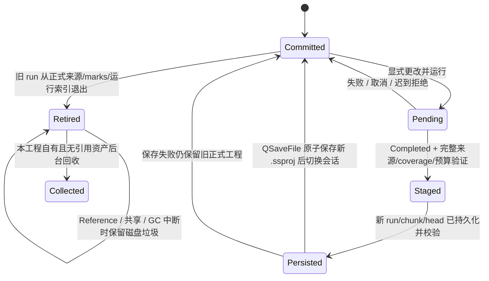

# UX-R5 检测结果与工程生命周期（R5-1）

## 权威索引

v6 通过可选 `currentDetectionSlots` 扩展，slot 键为 file 中的 sampleChannel，包含 committedRunId、generation、stale、retiredRunIds（仅 ID，无历史框）。源集合/marks 仍使用既有结构。旧工程缺字段时在临时 Project 中迁移，按最新已完成有效运行确定当前集合；相同时间/无可判定身份时明确诊断，不猜测删除。历史非人工人工修订先迁移成 Manual 自包含副本，再恢复只读原始几何，保留诊断。

## 崩溃与恢复

Stage / persist / commit 前失败只留下非正式孤儿资产，原 `.ssproj` 仍完整。commit 后即使 GC 中断，新工程唯一 slot 已权威生效；discover/recover 必须尊重 slot/retired ID，不能恢复旧正式 run。故障注入以真实 temp `.ssproj`、manifest 和分片验证各断点重开，仅集合 erase 测试不足以证明事务。

新算法来源发布必须走专用替换入口；`publishSourceSet` 继续承担验证/来源原子组装基础，不在 UI 直接决定算法最终集合。系统替换不进入人工 undo 栈，转换副本及后续人工命令不会复活旧算法。

## 通道与资产所有权

现有 AnnotationChannelSnapshot 是几何和 DDC 配置权威；退役算法标记不再需要留整对象，合法快照可脱离已退役 ID，通过明确 Retired 关系与 IQ 缺失区分。旧通道仍运行原采样率、source time/band、滤波和 source identity，绝不重绑。

Copy 新根只复制当前可达资产；Reference/Preserve 引用根不能作为私有垃圾场盲删。GC 校验 canonical 根、拒绝 reparse/symlink、仅删除 store 指定 run 文件；禁止触及外部 IQ、TXT、SigMF、模型。来源快照不含需 GC 的存储依赖。ProjectFileCodec 保持已有完整性校验、32 MiB 元数据及资产预算。

中间产物按本轮任务书写 `out/tasks/ux-r5/{logs,diagnostics,assets,local-builds}`；终审 `INDEPENDENT_REVIEW.md` / 发布记录放该目录提交外。最终 HEAD 本地提交之后独立审核；任何后续源码变更必须重新审核。
