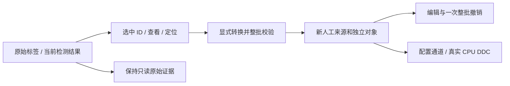

# UX-R5 交互与领域合同（R5-1）

## 三来源工作区

底部一级导航为原始标签 / 人工标记 / 检测结果，后台任务和日志保留独立入口。AnnotationPanel 共享分页/ID 引擎，按来源保存过滤状态、列与工具栏；每页最多 200 行。无“全部来源”混合业务入口。页面总数/筛选数/选择数均以本来源计算。

原始页可导入、定位、查看证据、转换、导出；人工页可新建/编辑/拆合/质量/删除/撤销/通道；算法页可定位、证据、转换、导出和显式重新检测。源对象只读状态明确显示，物理值不出现可写控件。低频操作复用已有溢出入口，不增加常驻长 JSON。

`AnnotationCapabilities` 为唯一用户写权限入口：Manual 且身份合法才能写、质量复核、删除和直接创建通道；另外两来源可查看/选择/定位/导出/转换。来源级导入管理、系统检测替换是独立事务，不由普通对象写 API 实现。图上只读对象没有控点和移动手势，仍有来源颜色、选择、悬停和定位。

`annotationEligibleForTab` 不受图层开关影响；`annotationSelectable` 按上下文和过滤判断，不受图层影响；`annotationOverlayVisible` 额外检查叠加层。Tab 切换取来源交集；图/树选择自动指向所属 Tab。所有操作以 ID 为键，选择不缩放，定位才缩放。

## 转换接口与不可变性

`ManualConversionOptions { currentSegmentOnly, allowExplicitDuplicate }`；`AnnotationService::convertToManual(FileState&, ids, options, createdIds)`。默认每个源对象一个副本、所有有效段；可选只复制当前段。未知 observation 不生成活动段。新 ID/sourceSet/revision，保留 class/name/note、原坐标系、半开样本区间与质量。单次命令承载全批，先验全部身份/范围/预算，再一次提交；默认同源同修订/段选项去重，明确“再次创建副本”才能重复。

副本增加兼容可选的 immutable conversion snapshot：源 annotation ID/revision/source kind、源 SourceSet 完整证据和原对象原始证据/必要几何。副本的编辑基准为转换时几何；外部源/旧 run 删除后不需解引用才能说明来源。不对大资产重复计算 SHA。

## 检测更新

每个 FileId + IQ sample channel 只有一个 CurrentDetectionSlot。算法/参数变化显示待更新，必须显式运行。任务暂存不混入正式集合；完成并通过完整性/上下文/token 校验后整体替换，零结果有效；ROI 不保留旧 ROI 外框，覆盖信息区分未检测。取消/失败保留上次事务完整状态，但标记待更新。

服务先准备新的 Project 候选，用 `.ssproj` 原子保存作为正式提交点，成功才交换会话集合。后台清理只处理已退出所有工程引用且明确属本工程资产根的旧运行。Reference/共享资产不删除。详细持久化合同见 DATA_LIFECYCLE.md。
