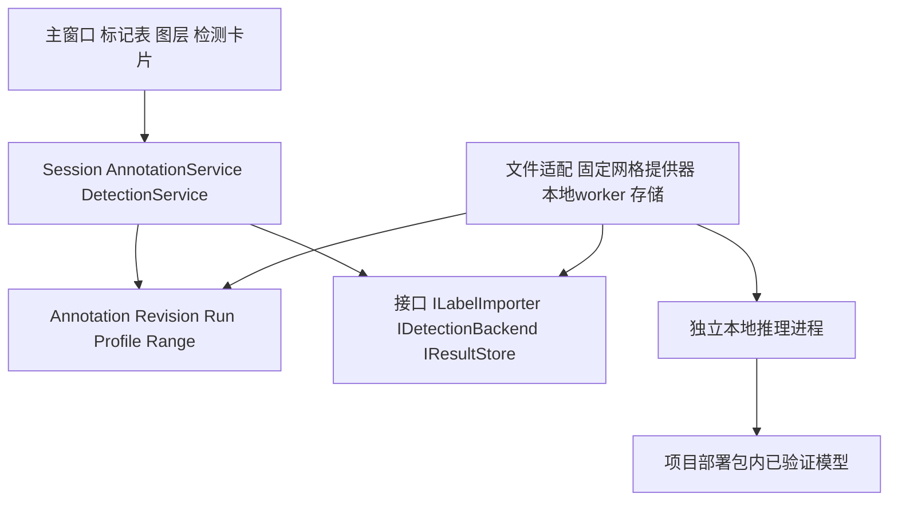

# 架构、计算契约与持久化

状态：待审核。下列名称是拟议模块，不表示代码已经存在。保持当前 C++20/Qt 6.11.1 分层，独立编写实现；参考仓库、原型和 W 盘数据不进入构建依赖。

## 1. 模块与依赖



| 层/拟议位置 | 职责 | 不应进入此层的职责 |
|---|---|---|
| `domain/annotation*`, `domain/detection*` | 范围、来源、修订、任务快照、模型能力、结果语义及校验 | Qt、磁盘、CUDA、Widget |
| `application/annotation_service*` | 导入/修订/复核命令、选择、撤销重做、通道关联 | 解析外部 JSON/TXT、推理 |
| `application/detection_service*` | 排队、状态、取消、分片发布、工程代际隔离 | 直接操纵图控件 |
| `infrastructure/label_import*` | 两类来源的解析与诊断；受限 WAV 元数据适配 | 直接修改 Session |
| `infrastructure/detection_source*` | 有界 IQ 读取、固定帧网格、上下文/映射/摘要 | 复用显示抽帧来补足推理输入 |
| `infrastructure/detection_worker*` | 版本握手、设备预检、输入传递、超时/进程回收 | 业务 UI、自动下载模型 |
| `infrastructure/annotation_store*`, `detection_store*` | 快照、分片、校验、原子发布与恢复 | 隐式保存所有用户工程草稿 |
| `app/detection_ui_controller*`, `ui/annotation*` | 当前界面接入、表格模型、覆盖层 DTO、用户命令 | 计算图/训练逻辑 |

首期一个计算任务运行，其余排队；标签/手动编辑与图谱显示不依赖推理 worker 存活。CPU 负责当前已实现的 DSP，QRhi D3D11 负责显示，TensorRT/CUDA 是否可用独立预检。D3D11 成功不等于存在可用 NVIDIA 推理环境。

本期只设必要后端接口，使用内置注册表；不交付外部 DLL 插件加载器、通用 DAG、远程服务和稳定 C ABI。原型 `get_api_v1` 继续作为未冻结草案。生产候选优先独立 C++/TensorRT worker，开发对齐阶段可用隔离 Python worker；若只通过 Python 验证，必须标明开发状态，不算原生发布完成。

## 2. 最小契约

| 契约 | 字段/要求 |
|---|---|
| SourceIdentity | projectGeneration、fileId、formatRevision、selectedSampleChannel、Fs/Fc/有效频带、physical/availableSamples、路径和快速指纹、读区间内容摘要 |
| DetectionProfile | profileId/version、模型/权重/engine hash、输入域与 shape、window/grid、归一化、解码、融合/噪底/时间定位版本、可调字段、已验证范围 |
| DetectionRequest | runId、不可变 SourceIdentity/profile/参数、requestedRange、contextRange、资源预算、报告语义版本 |
| SpectrumBatch | sequenceId、帧索引、样本 origin/hop、每帧实际样本映射/valid mask、freqStart/step/binCount、数值单位、存储 dtype/layout、尾部状态 |
| RawCandidate | stable local ID、原模型窗口/频带/分数、模型 classId（仅确有输出时）、源张量/物理映射、裁切状态 |
| EventEstimate |候选关联、trackId（可空）、活动段、时间质量、不确定度、边缘状态、修正原因和证据引用 |
| ResultChunk | runId、chunkId、sequence、schemaVersion、内容 hash、覆盖及排除区间、结果计数、终止/错误信息 |
| AnnotationProjection | Annotation 的当前修订与可视几何、来源/状态、选中态、证据引用 |

worker 通道用版本化控制消息和有长度边界的二进制数据块；不在 JSON 里塞大型浮点数组。控制消息明确编码、大小上限、消息类型和 request/run/sequence；二进制明确 endian、dtype、shape、stride、字节数与校验。worker 只读取主进程分配的本地任务数据，不提供任意脚本执行入口。协议版本不兼容即失败。

候选、事件和 Annotation 是不同阶段的表示，但最终 UI 只有一个 Annotation 主键。原始候选放不可变证据分片；事件更新有版本，投影按 stable key 去重。确认当前 revision 后又收到新的事件范围时，新增待审修订或等待事件 finalized，不能覆盖用户已确认范围。首期优先发布已完成窗口/已封闭事件，降低流式复核竞争。

Draft 4 的 EventEstimate 还需包含 `refineMethod/refineStatus/fallbackReason`、`scoreMean/scoreMax`、唯一 `windowIds/hits`、窗口覆盖率分母和父块→活动段关系，以重现 [08](08_FFSCN_TEST_GUI_CAPABILITIES.md) 的完整事件能力。窗口覆盖率、信号占空比、任务覆盖是三种量，不能共用一个无定义的 coverage 字段。评价配置独立版本化，记录真值 sourceSet/revision、TF-IoU 门限和匹配策略。

## 3. 固定网格与坐标

检测使用完整、按源样本编号排序的谱序列。网格 origin 固定于文件样本 0，hop 由 profile 明确计算（包含 Fs 非整除时的舍入规则）。ROI 改变不重置绝对帧时基；分块只改变读取批次，不改变帧、模型窗口或结果。

显示端 `analyzeSpectrogram` 的均匀抽帧、点预算、视区 FFT 和短窗处理不能直接作为检测输入。模型配置中的“10 帧”是 10 个真实时间槽，不是 10 条相同谱的复制；真实时间槽边缘 FFT 的补零与虚构缺失时间槽严格区分。短记录不足模型上下文时报告无法覆盖，除非独立 profile 已专门验证短输入。

HY 固定 1 ms 时间槽可能包含多个 FFT 或跨多个槽的长 FFT，必须保存每槽的真实观测支持区间；不能把 1 ms hop 称作 1 ms 时间分辨率。长 FFT 所需左右 halo 跨读取块保留，短 FFT 子记录的平均方法由 profile 决定。合法边缘补零保存有效样本与 padding mask，不通过补零宣称增加真实分辨率。

复数原始谱对应 `Fc + fftshift(fftfreq)`；实数沿用当前单边轴，不使用复数模型的变换。插值/裁谱/多尺度切片后的模型 bin 坐标必须通过显式映射回物理 Hz；明确 bin 中心与边界 convention，不能混用 `Fs/N` 和 `span/(N-1)`。GUI 主线全带宽对齐不擅自增加重采样；其子带能力参考整段 FFT 重采样，若独立实现为有界流式方法，须记录源/分析采样率、滤波延迟、裁切、原样本映射与新的预处理版本，并重新验证，不假定整段/分块自动等价。

对“检测某频段”，先按 profile 在需要的原始频带生成谱和上下文，再选择该 ROI 对应的模型切片并裁报告；不能把裁小的频带直接填满模型输入而丢失原 bin 映射。相邻长谱窗口先按固定规则融合，再做带宽修正与事件关联，去重键不得依赖线程完成顺序。

## 4. 状态、覆盖与并发

| 状态轴 | 取值/意义 |
|---|---|
| lifecycle | Queued → Validating → Running → Completed；另有 Cancelling → Cancelled、Failed、Interrupted |
| stageProgress | read、spectrum、inference、localization、persist 的独立计数，可同时变化 |
| sourceValidity | Current / Missing / Changed / Unsupported |
| coverage | requested、read、eligible、completed、excluded（按原因）、unread；二维范围及样本时间均可查询 |

Completed 表示任务按约定结束，不自动意味着整个物理文件被覆盖。Partial、模型暖机不足、尾部不足、频带排除和取消均保留具体区间；“未检测到信号”只能限定于已完成且可检测的范围。

每条回调携带 projectGeneration/fileId/runId/sequence。工程切换后丢弃旧代际更新；源文件被替换或格式参数改变则终止旧任务并标注来源变化。主线程仅提交轻量 DTO，队列采用有界背压，禁止推理速度超过 UI 后无限累计绘图信号。

初始资源预算建议：沿用 reader 单次解码/磁盘片段 32 MiB 上限；输入待处理队列最多 2 个块；CPU 中间缓存初始 256 MiB 可配置，结果分片最多 4096 条或 8 MiB（先到为准），图层更新最多 10 Hz。模型/设备内存另预检；这些是设计预算，M5 实测后记录调整，不是已有性能值。取消在读块、FFT 批、推理返回、落盘边界检查；不可中断的设备调用超时后回收 worker，UI 不阻塞等待。

## 5. 缓存与来源身份

当前 size/mtime 只用于快速变化检查；不能作为不可变内容身份证明。新任务记录读取区间 hash，标签配对/正式 golden 用完整文件 hash。大文件不强迫启动前全量扫描哈希，可边读边计算；报告必须说明摘要覆盖范围，未读尾部不可宣称已经校验。读前后检查来源元信息，运行中变化使结果失效。

分层缓存键：来源格式/通道/样本区间 → 谱网格/窗口/单位 → 预处理/模型/精度 → 解码与后处理 → Annotation 修订。显示配色、视图和图层显隐不进入计算缓存键。只改后处理参数可派生新 run 并引用相同原始候选，保留 parentRunId；不能原地改旧结果让历史参数失真。

原始标签和人工修订不进入模型输入缓存。标记被指定为 ROI 时只冻结其范围和 revision，不让标签类别、SNR 或真值边界参与检测。

## 6. 工程 v5 与结果目录

```text
project.json                         v5 工程与来源/修订索引
annotations/<setId>/source.*         导入的原始标签快照
annotations/<setId>/origin-*.json     归一化原始标记分片
annotations/<setId>/revisions-*.json  已提交人工修订/复核快照
detections/<runId>/manifest.json     配置、来源、覆盖、分片索引与终态
detections/<runId>/result-*.json     不可变候选/事件
detections/<runId>/evidence-*        有预算的谱/时间诊断证据
cache/detection/                    可清理且可重建的中间数据
```

目录名仅为设计示意。源标记和被引用模型结果属于工程数据，不放可随意清理 cache。大型原始 IQ 仍引用外部文件，不自动复制到工程。工程迁移后不再双写两套 Mark/Annotation；保留兼容访问层以逐步改造现有命令。

v1–v4 读取后：旧 Mark 原 ID/name/range 迁移为 LegacyManual Annotation 的单段，来源类型归 Manual，保留 legacy 标签；现有 selected/activeMarkIds 映射至统一 ID，Channel.sourceMarkId 继续可解析并增加来源 revision 快照。旧 Mark 没有来源证据，不能反推模型或伪造导入文件。完整校验新对象及全部通道引用后才替换 Session；迁移后首次由正常保存写 v5，不偷偷覆盖原工程。

持久化顺序：写临时分片并校验 → 同卷发布不可变分片 → 原子发布 manifest → 在内存挂入来源集合并标脏 → 用户正常保存时以 QSaveFile 原子替换 project.json。任务进度/结果可增量落盘，但不能顺带自动保存用户尚未确认的其它工程编辑。复核在工程快照中发布对应 revision 引用；存储层多文件写入不等于数据库事务。

崩溃恢复时以最后有效 manifest/工程索引为准；完整但未被工程引用的结果可列为可恢复来源，不能自动混入工程；临时/损坏分片不计入覆盖。缺证据与缺核心标记区别处理：缺可重建诊断可继续打开并提示，核心分片校验失败不部分替换当前 Session，可进入显式恢复副本流程。所有相对路径检查工程内归属，拒绝越界。

删除集合/运行先删视图索引或标记归档状态，保留被通道、修订或派生 run 引用的最小证据。垃圾回收需完整引用扫描并可报告回收内容，不沿用当前删除 Mark 时直接级联删除通道的实现作为默认行为。
