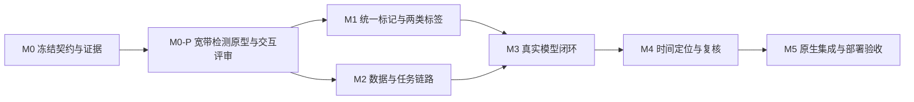

# 实施拆解、验收与评审清单

状态：全部为待执行任务。用户审核本规划后才能开始编码、模型转换或运行验收。本次交付只包含这些设计文档与来源核验记录。

Draft 4 新增 M0-P 原型与交互评审，明确原生功能开发的前置交付；模型主线调整为指定 FFSCN_TEST_GUI 的完整时频处理能力，详见 [07](07_PROTOTYPE_AND_INTERACTION_REVIEW.md)、[08](08_FFSCN_TEST_GUI_CAPABILITIES.md)。

## 1. 依赖与分期

先确认可点击原型的三来源标记、检测配置/状态和复核交互，再改原生功能。M1 与 M2 的设计边界可分别推进，实际修改共用 Session/project_store 时由同一集成顺序控制。M3 与 M4 共同构成 GUI 参考能力闭环，单有模型前向不算主线完成。

| 阶段 | 输入与任务 | 可审查交付 | 退出条件 |
|---|---|---|---|
| M0 契约冻结 | 审核 D1–D9；冻结 GUI 能力/profile、权重、参考数据/评价器；保持两类标签范围；核对部署环境 | ADR、golden 清单、profile manifests、字段/状态/存储 schema、资源预算 | GUI 与 HY 历史频率基线分开；G1 历史资料无法完整恢复时命名新基线；坐标/资产状态明确 |
| **M0-P 原型与交互评审** | 在指定宽带检测原型方向上补齐三来源、任务状态、精修证据与复核；保留当前 Qt 手势 | 离线可点击原型、合成场景数据、截图、P01–P17 映射、I01–I24 检查记录、评审差异 | S0–S9 可复现，关键动作可操作；交互方案经用户确认后进入 M1/M2；浏览器通过不作为 Qt/模型证据 |
| M1 标记基础 | 新 Annotation/Revision/SourceSet；v1–v4→v5；两类标签解析、受限生成器 WAV；迁移手动操作与通道引用 | 原生统一标记表/图层、来源与修订详情、导入报告、无损 JSON/CSV 导出 | 两类样例完整可读；重复导入无重复；手动编辑撤销重做/保存重开正确；旧通道不丢失；无检测运行时也可独立使用 |
| M2 数据与任务 | 固定网格有界 reader、profile 输入、背压/取消/代际隔离、run 分片/覆盖、worker 协议 | 完整离线任务链、可重现输入 golden、明确标示的算法夹具来源集合 | 分块等价；不取显示抽帧；Partial/EOF/源变化/崩溃正确；夹具只证明系统链路，不记为真实检测通过 |
| M3 真实前向与关联 | 对齐 GUI F01–F05：IQ/STFT/窗口/NMS/跟踪/频率处理；SCN 对照及生产 worker 预检，HY 频率历史单列 | 模型/运行时 hash、逐阶段差异、真实文件预测和统一 Annotation、SCN 证据 | L1/L2 与频率层对照通过；真实模型与来源正确；GUI 主线二维效果待 M4 完整验收，不提前宣称完成 |
| M4 精修、效果与复核 | 对齐 GUI F06–F10：sample/ROI 两种策略、分支参数、时间拆分/去重、二维评价；接已确认原型复核/通道 | 完整时频事件、原始/精修/fallback 证据、G/T 组效果、失败样例、端到端旅程 | L3/L4 通过或明确相应项未完成；不能以手动修边代替算法效果；接受不复制框、通道不静默重算 |
| M5 集成与交付 | 全部业务回归、规模/故障/资源验证、GPU/软件显示、独立启动 | Debug/Release 包、原生截图、CTest/UI/推理/性能分开的验收报告、限制列表 | 本期关键项通过；模型资产/环境可重复部署；没有外部业务源码运行依赖 |

不承诺未经测量的固定工期。M0 结果用于估算模型对齐/部署的实际工作量；标签和标记的交付不能被训练实验无限阻塞。TorchSig 上游模型集成、全格式标签系统、训练、设备、远程、插件/DAG、窄带识别解调和 Ubuntu 运行验收不在本期。

## 2. 可分配任务清单

| ID | 主要变更位置（拟议） | 具体结果 | 主要行为检查 |
|---|---|---|---|
| T00 | `docs/prototype/wideband-detection-r1/`（拟建） | 可点击宽带检测与三来源标记原型、状态数据、截图、评审记录 | 07 的 P/S/I 编号全覆盖；检查现有手势兼容及模拟标识 |
| T01 | domain/annotation、application/annotation_service | 统一实体、多段、修订、复核、命令与选择 | 同 ID 无双份记录；撤销/重做原子；来源不变 |
| T02 | infrastructure/label_import | 生成器 TXT 与 TorchSig SigMF+配套 JSON | 字段/坐标/配对/错误报告、重复导入、原始证据保留 |
| T03 | infrastructure/source_metadata、import UI | 受限双通道 PCM16 WAV 映射至现有 reader | RIFF chunk、Fs/样本/IQ顺序、尾部、未知格式拒绝；RAW/SigMF 回归 |
| T04 | infrastructure/project_store、annotation_store | v5 与旧版本完整迁移、分片及引用检查 | Mark ID、选择、通道、旧参数保留；写失败/损坏不替换当前状态 |
| T05 | ui/annotation、plot_widget、main_window | 表格/来源层/详情、标记手势及数值编辑 | 三来源、多段、重叠选择、无滚轮误改、草稿隔离、十万段压力 |
| T06 | infrastructure/detection_source | 固定时间网格与模型张量映射 | 多分块边界、不同采样率、EOF/Partial、real/complex、zero padding语义 |
| T07 | application/detection_service、worker/store | 任务排队、生命周期、取消、覆盖和存储 | 同 run 去重、旧代际丢弃、worker 失败、源文件替换 |
| T08 | 新模型适配器与配置 | GUI IQ 主线、HY 独立历史基线、SCN 对照、FFSCN-17 实验注册 | hash/shape、预处理/NMS、设备兼容及实际前向，不能模拟通过 |
| T09 | 时间定位/事件关联 core | GUI sample/ROI/粗定位/不拆分组合、多段、唯一窗口证据与二维评价 | 1–8 ms、同频间隔、嵌套/重叠、门限生效、fallback 与原样本映射 |
| T10 | application/session、通道弹窗 | 按确认活动段建 DDC，保存修订快照 | 来源编辑/删除/拒绝后依赖状态、保护带/输出率/实数限制 |
| T11 | 评价与诊断工具（实施时新建） | 历史回放、独立 holdout、分组报告 | 真值版本/分数/名义BW分开；不静默排除失败样本 |
| T12 | CMake/部署脚本/验收 docs | 原生发布、资产预检与能力声明 | 干净输出目录启动、模型缺失可解释、GPU证据与推理证据独立 |

## 3. 验收矩阵

| 编号 | 必须观察的行为 | 证据形式 |
|---|---|---|
| A01 | 用户指定 TorchSig 文件读入为 400000 个复样本、20 ms、4 个标记；RF 与基带均无二次偏移 | 输入 hash、字段对照、原生视图、保存重开记录 |
| A02 | 生成器 TXT 多 TIME 段完整；WAV 无逐样本/通道偏移；时间量化说明保留 | writer 样例、解析期望、读样本对照及标记截图 |
| A03 | 两类标签之外的原始标签格式不自动猜测；配套 JSON 不产生第二份框 | 拒绝诊断与幂等导入结果 |
| A04 | 手动、标签、算法三来源共用选择/表格/图层；修改原始来源建立修订 | 原生交互测试、命令日志、导出原始/当前值 |
| A05 | 接受/拒绝/撤回复核/修改/撤销重做后 ID、数量、状态及来源正确 | 有下游通道和无下游通道两组流程 |
| A06 | v1–v4 Mark 与通道原值迁移；v5 重新打开无丢失；非法输入不部分替换 | fixture 前后摘要、失败后当前 Session 一致性 |
| A07 | 检测只读取快照范围，完整网格不依赖显示抽稀/缩放 | 相同源不同视图和块大小的张量/结果对比 |
| A08 | SCN 仅最大谱推理；平均谱邻带取最小值，避开候选并只内缩 | 可解释合成谱数值夹具与真实谱证据；空邻带 skip |
| A09 | GUI 主线全链路与固定评价器同源对照；HY 频率独立报告，FFSCN-17 超差配置不标正式通过 | 分阶段误差、时频/频率分别报告、权重与 profile 状态 |
| A10 | 未知时间不画精确事件；两个短突发不桥接成连续发射 | 时间标注、逐帧/样本证据和专项指标 |
| A11 | Partial、取消、崩溃、磁盘满、读取失败、源变化、切工程均保留覆盖事实 | 状态/分片/恢复故障注入记录 |
| A12 | 真实算法标记确认→通道参数→真实 CPU DDC→保存重开 | 原始文件 hash、run/model/revision、通道数据和原生截图 |
| A13 | 无模型或无兼容 GPU 时仍可导入标签、手动编辑、查看历史结果 | 缺资产/不支持设备启动记录；不替换成合成“检测” |
| A14 | 100000 活动段、长文件检测不全量载入/全表建控件；UI 可取消操作 | 内存峰值、显存、冷/热启动、吞吐、P50/P95交互延迟 |
| A15 | GPU 显示与软件回退各自通过；推理设备独立记录 | QRhi driver/纹理上传证据、TRT设备/版本/shape证据 |
| A16 | 原型 S0–S9、I01–I24 与 Qt 实现逐项一致；原型中的模拟功能已被真实实现或明确标未完成 | 原型版本/hash、评审差异表、Qt 对应测试/截图；禁止用原型截图替代 Qt |
| A17 | sample/ROI/fallback 可区分；命中按唯一窗口，平均/最大分数有定义；TF-IoU 每阈值一对一匹配 | 参数分支夹具、失败样例、评价器反例、独立数据集报告 |

M5 建议 UI 目标：普通标记选择/过滤首屏响应 P95≤200 ms，长任务启动和取消按钮在 200 ms 内反馈状态；取消完成延迟另测（受单次设备调用限制，不混为界面反馈）。冷/热推理及全链路都报告，不把纯 GPU kernel 时间当产品速度；吞吐不设未经实测的“实时”宣传目标。压力夹具通过也不证明真实模型效果。

## 4. 回归与原生证据

实施时先执行与变更相符的 domain/application、解析/持久化及 UI 测试，再通过本项目 `scripts/build.ps1` 完成需要的 Debug/Release 构建、CTest 和部署验证。只运行本仓库测试证明本仓库；外部报告只作对照。现有宽窄带谱参数隔离、真实 DDC、多格式导入、项目入口和参数提交语义均为回归点。

视觉只在第二连接屏 Redmi 27 NU（DISPLAY6）、3840×2160 物理、150% DPI 的实际全屏窗口验收，记录第二连接序号、友好名、设备路径、物理/逻辑尺寸。截图应包含有真实数据和三来源标记的场景；空工程/浏览器原型不能替代。D3D11 与 QWidget 软件路径分开验收，GPU smoke 必须有非 CPU driver 与实际纹理上传；offscreen UI 测试不证明 GPU。

可执行文件从对应输出目录独立启动，不依赖参考源码/原型/Qt 安装目录。模型资产可以是显式配置的独立资源包，但应有 manifest 和缺失提示，不能依赖开发机训练仓库隐含路径。部署测试记录目标 NVIDIA GPU 与 TensorRT/CUDA 环境，不用原 QRhi AMD 驱动信息推断模型可运行。

## 5. 审核决策与后续入口

| 决策 | 建议 |
|---|---|
| D1 范围 | 本地离线、单文件单 ROI、一个计算任务与队列 |
| D2 模型 | 指定 FFSCN_TEST_GUI 完整时频处理链为主线；HY 频率独立历史对照、SCN 对照、FFSCN-17 实验 |
| D3 状态 | 取消保留完整片段；暂停/跨进程续算后置 |
| D4 标记 | 三来源同一 Annotation；原始证据不可变、人工修订单独保存；接受不复制框 |
| D5 保存 | 工程 v5、旧 ID/通道兼容、结果分片；任务落盘不隐式保存其它工程草稿 |
| D6 推理交付 | 本地 worker，开发适配与正式部署分别验收；不在本期搭建插件/远程平台 |
| D7 标签范围 | **仅生成器 TXT 与 TorchSig 指定 SigMF**；配套 rfbench JSON 只作同源补充，不加入其它原始标签适配 |
| D8 配对数据 | 补齐生成器双通道 PCM16 WAV 的受限输入，避免标签适配后原始样本仍打不开 |
| D9 原型 | 将可点击宽带检测与三来源标记原型列为 M0-P，先交互确认，再进入 Qt 功能实现；M5 独立做原生/模型验收 |

用户本轮关于参考会话用途与标签范围的指令已经纳入，不需要再确认其含义。其余条目是可整体或逐项审核的方案；收到审核意见后先更新本规划，只有明确同意进入执行后再开展实现。
