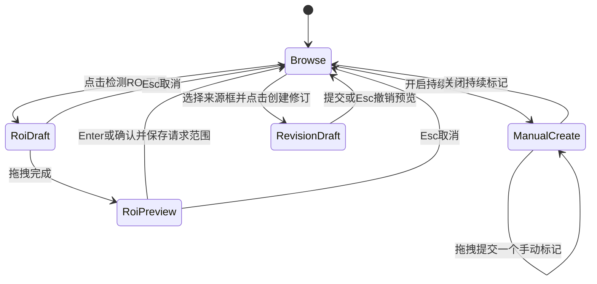

# 宽带检测原型与交互评审方案

Review Draft 4 · 2026-10-13 · 待审核。

本章补齐上一版没有单列的原型工作、交互追踪和评审交付。**原型是首期正式任务，不是算法接入完成后的附属演示。** 本轮给出可审核的页面状态、交互规则和验收脚本；新版可点击原型尚未制作，须在本规划获批后按 M0-P 交付。外部原型与原生源码本轮均未修改。

## 1. 设计依据与现有原型

三类依据分工明确：当前 A1.4.3 原生界面决定主工作区和既有手势；指定 `SignalStudio_Triggered_Design_b151f143` 决定宽带检测增量入口与交互方向；[审查 FFSCN_TEST_GUI](codex://threads/01a052c9-0ce5-7e41-a376-2c4a677ce9ca) 决定能力、效果及结果需要表达的语义。**不把 FFSCN_TEST_GUI 的顶部布局、左栏、默认拖动方式搬进 Signal Studio。**

可回看：[原宽带检测 HTML](D:/project/signal_studio_原型设计/SignalStudio_Triggered_Design_b151f143/prototype/index.html)、[原交互截图](D:/project/signal_studio_原型设计/SignalStudio_Triggered_Design_b151f143/screenshots/prototype-interactions.png)、[原交互设计](D:/project/signal_studio_原型设计/SignalStudio_Triggered_Design_b151f143/docs/02_OFFLINE_DETECTION_UX.md)。已核对 HTML/JS 和截图，不能把按钮文字当作功能已验证。

| 原型项 | 原型中的实际形态 | 本期决定与去向 |
|---|---|---|
| P01 检测入口 | 分析菜单、宽带条按钮、主图右键 | 保留三个入口，均打开同一检测卡片并预设范围；快捷键冲突在原型/Qt 分别核对 |
| P02 检测卡 | 当前文件下面可折叠卡，算法/范围/高级参数 | 保留落位；方案优先展示 FFSCN GUI IQ 能力配置；SCN/FFSCN-17 分列状态，移除“双分支 SCN” |
| P03 范围 | 可见区域、全可用文件、活动标记、ROI | 保留；冻结到样本/Hz，活动标记多段时先选一段 |
| P04 ROI | 独立工具，JS 拖完即设置范围 | 增加拖后待确认状态，Enter/确认提交、Esc 取消；不创建标记、不自动启动 |
| P05 三图与模式 | 全局导航、辅助波形/PSD、主时频/瀑布 | 保留当前结构和坐标联动；候选和三来源标记都使用同一物理投影 |
| P06 持续手动标记 | 右键开关，连续创建手工框 | 保留；检测 ROI 临时占用手势后恢复前一工具 |
| P07 图上编辑 | 单击选择、选中后八手柄与框移动 | 手动标记直接编辑；原始标签/算法先进入修订模式；选中只读框不改原始值 |
| P08 任务 | 模拟阶段定时进度和取消，无部分结果 | 新原型演示排队/执行/取消中/部分完成/失败；生产进度来自实际计数，不能复制定时器 |
| P09 底部结果 | 新增独立“检测结果”页 | 因三来源要求改为统一“标记记录”，保留任务/日志和文件通道摘要；增加来源/run 筛选 |
| P10 工程树 | 手工标记和运行摘要 | 升级为原始标签/手动/算法集合，运行只挂摘要；大量候选进入表格 |
| P11 复核 | 接受会新建 reviewed-* 手工 Mark | 改为同一 Annotation 的 Review；来源不变，不复制框；撤销/重做单独命令 |
| P12 时间未知 | 表格有“仅频带”，图上仍画完整矩形 | 改为窗口观察带/底纹；只有定位成功或人工指定时间才有活动段框 |
| P13 参数 | NFFT、重叠、置信度、CNR 通用一套 | 按 profile 和精修分支启用；显示 FFT 窗/谱步长/上下文/滑动时长，标清分数与估计噪底含义 |
| P14 创建通道 | 演示弹窗、通道计数加一 | 原型保留弹窗与依赖情景；原生接真实 DDC 校验，限定确认的活动段 |
| P15 导出 | demoOnly JSON 下载 | 新原型仅输出带 demoOnly 的状态快照；正式无损 JSON/CSV 按 06，保留来源及修订 |
| P16 暂停/合并/拆分 | 文档提及范围大于 JS 实际能力 | 首期不做暂停/续算；明确保留单对象活动段拆分/合并，跨来源自动融合后置 |
| P17 标签与模型证据 | 原型缺原始标签集合与精修证据 | 新增两类标签导入预览、三图层、sample/ROI/fallback 卡及真值对照状态 |

原型里的 `quickDetect` 会直接模拟运行、主图背景没有完整实现当前 Qt 缩放手势、双击结果只提示定位、Esc 在任务运行时有分支限制。这些都不能作为交互验收完成。新版按下述规则补齐，与已有 A1.4.3 手势回归逐项对照。

## 2. 页面布局与线框

评审主尺寸为 2560×1440 逻辑工作区。保留当前 Brand v2、Qt 工作区和三图比例规则；底部初始建议 240 逻辑像素且可拖动，最小主图空间受布局约束。右栏高级内容滚动，固定操作区不会被长路径/物理时长文字挤出。原型画布尺寸只说明设计目标，不能作为第二屏原生 DPI 验收。

```text
┌ 文件  编辑  视图  分析[宽带信号检测…] ─────────── 项目/来源/状态 ┐
│工程树           │ 宽带时频研判                   [检测…] │当前文件/分析参数│
│ 文件            │ 全局时间导航  + 当前可见范围            │ 文件信息        │
│  标记           │ 辅助波形 / PSD / 检测证据               │ 宽带检测 ▾      │
│   原始标签(4)   │ 主时频图 / 瀑布图                       │ 方案 / 范围     │
│   手动(1)       │ [标签✓ 手动✓ 算法✓] [ROI] [创建标记]    │ 参数 / 精修方式 │
│   算法/run…     │ 原始标签框、算法事件框、选中修订手柄    │ 物理时长卡      │
│  检测运行       │ 坐标 / 可用范围 / 已选  [建窄带通道]    │ [运行] [取消]   │
│  窄带通道       ├ 标记记录 | 后台任务 | 日志 ────────────┤ 标记详情 ▾      │
│                 │ 来源/run/状态过滤 · 可见 n / 已选 n    │ 原始/当前边界   │
│                 │ 名称 来源 状态 时间/时长 中心频率 带宽  │ 精修证据 / 备注 │
└─────────────────┴─────────────────────────────────────────┴─────────────────┘
```

“原始标签(4)”来自指定 TorchSig 样本的结构演示；算法数量不得假装是该样本实测检测数。新版可点击原型的默认演示用足够上下文的文件时长，另设“数据不足”场景，不沿用固定 2.56 ms 却不检查模型上下文的演示。

检测卡将“方案/范围/运行”与“标记详情/复核”分组，选中结果不会覆盖任务参数草稿。物理时长以短标签分行：FFT 窗、谱步长、模型帧数/标称时间、窗口滑动；详情解释真实观测支持。结果首屏突出中心频率、带宽、开始/结束与时长；算法来源默认还可见平均模型分数，最大分数及窗口统计放详情；不复制外部 GUI 的固定 0.90 高置信配色语义。

## 3. 必须交付的页面状态

| 状态 | 可见内容与可用动作 | 不能发生的行为 |
|---|---|---|
| S0 无工程/无数据 | 原工程入口；检测按钮显示不可用原因 | 自动加载模型/演示结果冒充真实数据 |
| S1 文件 Ready + 标签已导入 | 三来源图层、来源集合、标签数量/字段；可手动标记、选方案 | 标签自动创建 DDC，JSON/meta 重复框 |
| S2 Loading/Partial | 加载进度或可用前缀；检测范围明确受限 | 用全物理时长宣称已检测 |
| S3 配置/ROI 待确认 | ROI 预览、物理范围、提交/取消、有效参数和预检 | 一次拖拽同时缩放、创建标记和启动检测 |
| S4 模型未就绪/短上下文 | 具体原因、可调整的方案/范围；标记仍可编辑 | 静默用假检测、重复谱帧补齐时间 |
| S5 排队/运行 | 任务快照、阶段计数、取消；图谱可浏览；草稿注明用于下次 | 浏览导致本次范围变化、旧结果被重新标记为新参数 |
| S6 取消/失败/部分覆盖 | 已发布片段、未分析区域、错误摘要与技术详情 | 进度定时到 100%、部分结果当全文件结论 |
| S7 完成/零结果 | 已分析范围与输出数；零结果是正常状态，独立于失败 | 零结果提示等同模型未加载 |
| S8 复核/修订 | 原始/当前边界、sample/ROI/fallback、接受/拒绝、撤销/重做 | 直接改原标签、接受后画两个框 |
| S9 通道/持久化 | 通道来源 revision、变化状态、保存重开 | 重新检测或修订自动覆盖已有 DDC |

S8 还包含观察频带、粗时间事件、sample 精修成功、ROI 精修成功、精修回退和人工修订六种结果卡。选择不同卡必须能看出其时间依据，不能都显示为同一种“精确检测框”。

## 4. 手势优先级与状态转换

本轮核对当前 `PlotWidget::mousePressEvent`：主图背景左键拖动是框选缩放，坐标轴拖动按时间/频率平移，选中手动标记可编辑；滚轮按所在区域控制轴。**继续这一套基线，不把 FFSCN_TEST_GUI 默认左键平移改为本项目默认。** 新的 ROI/标记工具显式切换，鼠标提示随工具变化。



状态图中的 Browse 表示恢复之前的浏览/工具状态；若 ROI 从持续标记进入，退出后恢复持续标记。图谱工具状态与 DetectionRun 生命周期相互独立：运行时按 Esc 也必须退出当前草稿工具/关闭临时弹层，停止检测仅通过“取消任务”。右键/窗口失焦/切文件/模式切换必须清理鼠标捕获并回滚未提交几何，不遗留拖动状态。

命中优先级：当前工具→可编辑选中对象的手柄/本体→单击对象选择→背景浏览。标签和算法原始框默认不可拖动，选择后可进入修订模式；密集重叠时列出名称/来源/段号供选择。浏览模式拖动跨过只读框按既有背景操作处理，不能误改标签；判定点击和拖动使用同一阈值。主图、时频/瀑布轴变换、辅助证据、表格和工程树共享物理范围与 ID。

## 5. 可直接执行的交互验收脚本

| ID | 前置与动作 | 预期结果 |
|---|---|---|
| I01 | 菜单、范围条、右键分别进入检测 | 同一卡片，范围正确；“检测…”先配置，不隐式跑全文件 |
| I02 | 在运行前修改视图；运行后再缩放 | 提交前范围可更新；提交后任务快照不变 |
| I03 | 开持续标记→进入 ROI→拖拽→Esc | 无新标记/任务；恢复持续标记 |
| I04 | ROI 拖拽→Enter；拖到数据边缘 | 范围合法并明确提交；不超可用时间/有效频带 |
| I05 | 背景框选缩放、轴平移、滚轮至边界 | 与 A1.4.3 现有语义一致，视图有界，标记几何不变 |
| I06 | 时频↔瀑布切换并选同一活动段 | 同一物理时频对象，选择保持，轴方向映射正确 |
| I07 | 在重叠来源框上单击；Ctrl/Shift 多选 | 能辨别并选择目标；所选集合在表/图/树一致 |
| I08 | 拖手动框及八手柄、数值修订；Esc/撤销/重做 | 松开仅一次命令；约束合法；取消恢复原值 |
| I09 | 试拖原始标签/算法框；进入修订再拖 | 初始只读；修订后原始值可查，sourceKind不变 |
| I10 | 接受同一算法结果两次，拒绝后恢复 | 一个 Annotation、一个框；复核状态可追溯 |
| I11 | 分数筛选、排序后多选并批量复核 | 数值排序；按钮明示已选数；不改未选隐藏对象 |
| I12 | 切三来源图层、来源/run筛选 | 显示/可见统计变化，存储总数与计算结果不变 |
| I13 | 选择 sample、ROI、粗定位和不拆分 | 只启用生效参数；物理单位和结果时间语义正确 |
| I14 | 参数输入一半→后台刷新/应用失焦；再 Enter/Tab | 草稿不被应用/覆盖；有效提交后才更新下一次配置 |
| I15 | 滚轮经过输入框、下拉列表、侧栏和图谱 | 参数不变；侧栏正常滚动，图谱正常缩放 |
| I16 | 运行→取消；随后模拟失败、零结果、缺模型 | 四种状态可区分；历史标记保留；覆盖说明准确 |
| I17 | 同工程切文件、再切工程 | 当前图不串标记；旧工程回调被隔离 |
| I18 | 未定位频带、sample/ROI/fallback 逐一选中 | 不伪造时间；方法、原始/当前值、失败原因可查看 |
| I19 | 多突发标签→单段拆分/合并活动段 | 间隔不被画实；操作限定对象，保留修订关联 |
| I20 | 导入生成器 TXT；导入 TorchSig meta/data/json | 两类正确配对；相同集合幂等；展示量化和绝对RF差异 |
| I21 | 标签/meta配套冲突或 Partial 前缀不足 | 明确诊断；不丢原始字段、不截断有效标签 |
| I22 | 确认一段→通道弹窗→修改来源标记 | 参数校验；通道保留原revision并提示来源变化 |
| I23 | 保存重开、导出、源缺失、结果文件损坏 | UI展示对应状态与来源；原型仅模拟状态，Qt阶段做真实文件验证 |
| I24 | 调整底部/侧栏、最大化图、长名称/极大RF值 | 无关键按钮遮挡，物理时长卡换行，主图可用，布局可恢复 |

## 6. 原型交付与阶段边界

新增里程碑 **M0-P：宽带检测与统一标记可点击原型**，在原生功能开发前完成。建议在本仓库 `docs/prototype/wideband-detection-r1/` 独立建立审阅副本，不覆盖 A1.4.3 冻结副本和外部触发原型；该目录目前尚未创建。

| 交付物 | 内容 | 完成判断 |
|---|---|---|
| 原型页面/资源 | 离线可打开的 HTML/CSS/JS，保持当前布局，覆盖 S0–S9 | 菜单/ROI/选择/修订/任务模拟/通道模拟可点；不是仅几张效果图 |
| 演示状态数据 | 三来源、多突发、重叠、未知时间、精修成功/回退及错误状态 | demoOnly/合成数据标识常驻；数据切换可重复复位 |
| 交互说明与检查记录 | P01–P17 处理矩阵、I01–I24 的操作与结果 | 不支持项明确列出，不把占位按钮计作通过 |
| 审阅截图 | 主界面、ROI确认、运行/取消、三来源复核、精修证据、导入冲突、建通道 | 在目标逻辑工作区可读；注明浏览器原型与模拟数据 |
| 评审差异记录 | 原型版本/hash、用户意见、采纳/后置原因、对应 Qt 工作项 | 交互方案确认后进入 M1/M2 原生实现；有争议项不默认为认可 |

M1/M2 将已确认原型独立实现为 Qt 界面与状态层；M3/M4 将原型状态替换为真实数据/任务/模型证据；M5 按同一 I 编号在第二连接屏做原生验证。不能用浏览器交互通过代替 Qt，也不能用 Qt 夹具通过代替模型效果。

本次审核重点：是否认可此原型范围、当前手势保留方式、统一底部标记页、六类时间证据卡，以及“先交互原型确认，再进入原生功能实现”的次序。它们已与模型能力工作并列为本期交付，不再留到最终集成才处理。
