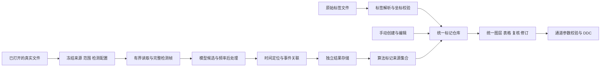

# 宽带信号检测与统一标记体系规划（待审核）

版本：Review Draft 4 · 2026-10-13（北京时间，补充 FFSCN_TEST_GUI 主线及原型交互专项）

项目：Signal Studio / `rebuild/a143-native`

核对基线：`b151f14324b595d34e8b260ed9f84308a4bb4c80`

执行授权更新（2026-10-13）：用户已批准执行本规划全部本期任务，并要求每节点本地提交、全部完成后推送。下文保留审核时的设计快照；当前节点、提交与真实验证结果以 [执行状态](../../implementation/wideband-detection/EXECUTION_STATUS.md) 为准。

本次只交付规划与设计，不实现检测功能，不转换模型，不启动训练，不提交或推送。用户审核确认后，才按本文里程碑实施。文中的新类型、文件名、指标门槛和界面行为均为拟议方案；当前事实及历史证据分别在来源文档中标明。

## 1. 建议结论

本期同时完成两条主线：**添加真实宽带检测能力；改造现有标记的记录、交互和展示，统一原始标签文件标记、手动标记、算法检测结果标记。** 三类标记共用坐标、选择、编辑、列表、图层和通道关联，同时保留来源与修订差异。保留 A1.4.3 三图结构、Signal Import A1.2、Brand v2、真实 DDC 和 QRhi 显示。

原始标签只适配两类：`broadband_signal_generation` 的 TXT，以及 [TorchDSP/torchsig](https://github.com/TorchDSP/torchsig) 背景下用户指定的 SigMF 数据集。已核对 `W:/wbSig53_rfbench20m/train/baseline/0000000` 三个配套文件；SigMF 元数据为主、同名 rfbench JSON 补充，四个事件只导入一次。详细字段和样例见 06。

参考会话主要用于提取模型能力、输入条件、结果语义、实测效果及限制；不以这些项目的界面流程或使用方式作为当前产品设计依据。当前交互以本项目代码、指定原型和用户本轮要求为依据。

首轮能力主线改为用户指定 [审查 FFSCN_TEST_GUI](codex://threads/01a052c9-0ce5-7e41-a376-2c4a677ce9ca) 中优化后的 **IQ→STFT→滑窗检测→关联/融合→sample/ROI 精修→时频事件→二维评价**。该会话报告优化后 10 文件、594 真值块，TF-IoU≥0.5 的 P/R/F1 为 0.8941/0.7677/0.8261；这是历史参考结果，本轮没有重跑。HY epoch-210 的 1000 文件频率评估独立保留，不能混作该 GUI 的二维效果。SCN 最大谱作对照，FFSCN-17 仪器谱作实验配置。正式部署仍须在本项目完成数值与真实数据验证，详见 08。

**宽带检测原型与交互是本期独立交付。** 新增 M0-P，在总体规划获批后先制作包含三来源标记的可点击原型，按页面状态和交互脚本评审，再进入 Qt 功能实现。当前轮次只补全设计文档，没有制作新版 HTML 或修改外部原型；交付物、17 项原型映射、10 类状态和 24 条交互检查见 07。

当前最需要补齐的是原型交互确认、标签导入与标记模型、完整检测帧生成、冻结参数与来源、参考时间精修能力、人工复核和持久化。原型阶段一起设计三来源交互；原生阶段先做统一标记基础，再接入算法结果。通用 DAG 编辑器、第三方 DLL、远程计算、设备输入和窄带算法全面迁移放入后续阶段。

本版相对 Draft 3 的主要变更：补读指定 GUI 会话的 5 个轮次及当前代码；将其完整时频能力提升为主线；区分优化前、优化后和历史频率评估；新增原型交付/评审里程碑，并补齐现有 Qt 手势与检测交互的对应关系。两类原始标签范围及统一 Annotation 方案保持不变。

## 2. 相比原型包的主要优化

| 原型中的问题或不足 | 本规划的处理 |
|---|---|
| SCN 文档、manifest、界面仍有“平均+最大双分支推理” | 固定为最大谱推理；平均谱用于邻带最小值噪底估计，带宽只向内收缩 |
| SCN/FFSCN 使用统一“FFT、重叠、置信度”界面，容易误用 | 按 `profileId + version` 管理模型、分帧、归一化、解码和后处理，显示谱参数与检测参数隔离 |
| HY FFSCN、FFSCN-17 仪器谱适配容易混为一谈 | 独立配置、独立 golden、独立效果结论；epoch-210 与 epoch-155 不互相代称 |
| Hann/50% 被当作通用建议 | 不设跨模型默认值；HY 固定 1 ms 分帧的特殊计算先逐阶段对齐 |
| 原型已有模拟矩形，真实时间边界尚无依据 | 区分窗口观测、事件估计、人工边界；不确定结果只能画带状观测区域 |
| 将推理预热、扫描、定位写成单一线性状态链 | 生命周期、流水线阶段、来源有效性、覆盖完整性分别建模 |
| 单文件原子写被当作整个工程多文件事务 | 不可变结果分片先落盘，manifest 后发布，最后更新工程索引；复核通过工程快照提交 |
| 底部全字段表、树中全部候选会膨胀 | 表格用模型/代理分页，详情按选择展示；树只放运行摘要，图上按视区索引 |
| 当前 Mark 只有 id/name/range | 建立统一 Annotation、来源集合和修订模型；三类标记共用管理界面，标签/模型原始记录不可变 |
| 原始标签容易被统称为精确真值 | 区分生成器 TXT 时间量化/名义带宽与 TorchSig 样本起止；RF 与基带坐标明确转换 |
| UI 集成排在算法和时间定位之后 | 先贯通标签导入和手动标记，再以明确标示的算法夹具接入同一体系；夹具通过不算检测完成 |
| 上一版未单列新版原型交付及交互评审 | 新增 M0-P、页面状态、24 条操作检查及原型→Qt→真实模型的证据分层 |
| 上一版未重点呈现 GUI 已有二维检测与效果 | 以 FFSCN_TEST_GUI 完整处理链为主线，补充 10 文件二维评估与复现边界 |
| 全插件平台与本期交付混在一起 | 首期只固定必要契约和一条本地 worker 通道；外部插件与远程协议后置 |

## 3. 阅读顺序

| 文档 | 主要用途 |
|---|---|
| [07_PROTOTYPE_AND_INTERACTION_REVIEW.md](07_PROTOTYPE_AND_INTERACTION_REVIEW.md) | **本轮重点：宽带检测原型映射、页面线框、状态、手势、24 条检查、原型交付与评审** |
| [08_FFSCN_TEST_GUI_CAPABILITIES.md](08_FFSCN_TEST_GUI_CAPABILITIES.md) | **本轮重点：指定 GUI 会话的能力、二维效果、当前实现及证据边界** |
| [01_SOURCES_AND_AUDIT.md](01_SOURCES_AND_AUDIT.md) | 六组会话对应关系、现有代码接入点、原型偏差、证据可信范围 |
| [02_UX_AND_REVIEW.md](02_UX_AND_REVIEW.md) | 当前界面增量、范围选择、任务状态、候选复核、标记/通道关系 |
| [06_UNIFIED_ANNOTATIONS.md](06_UNIFIED_ANNOTATIONS.md) | **重点审核：三类标记的统一记录、标签格式、修订、图层、编辑与导出** |
| [03_ARCHITECTURE_AND_CONTRACTS.md](03_ARCHITECTURE_AND_CONTRACTS.md) | 模块边界、分块网格、数据契约、并发、缓存、v5 与异常恢复 |
| [04_ALGORITHMS_AND_VALIDATION.md](04_ALGORITHMS_AND_VALIDATION.md) | GUI 主线与三类对照配置、时间定位、数据域、golden 与效果评估 |
| [05_MILESTONES_AND_ACCEPTANCE.md](05_MILESTONES_AND_ACCEPTANCE.md) | 任务拆解、依赖、交付物、退出条件、验收矩阵和评审项 |
| [source_fingerprints.json](source_fingerprints.json) | 本次实际读取的关键文件 SHA-256 与原型包一致性检查 |

## 4. 产品与计算流程

显示缩放、配色、辅助 PSD 和视图切换不进入这条检测计算链。任务使用提交时快照，后台结果按 `projectGeneration/fileId/runId` 回传，不因用户浏览另一个文件而串入当前视图。

## 5. 本次希望审核的决策

| 编号 | 推荐决定 |
|---|---|
| D1 | 本期先做本地离线、单文件单 ROI；一次一个计算任务，其余排队；不加入设备、远程上传、训练 |
| D2 | FFSCN_TEST_GUI 优化后的时频检测/精修能力为主线；HY epoch-210 频率评估作独立历史对照，SCN 作对照，FFSCN-17 作实验 |
| D3 | 首期支持取消和保留已完成片段，不承诺暂停/跨进程精确续算；重新运行创建新 run |
| D4 | 三类标记统一为 Annotation；来源/原始证据与人工修订分开。接受算法标记只改变复核状态，不复制出第二个框；已确认有效范围才能建通道 |
| D5 | 工程 v5 保存统一标记索引、手工记录、来源集合与修订关联；大标签/检测结果在工程内分片，兼容 v1–v4 Mark 和通道引用 |
| D6 | 首期用本项目独立实现的本地 worker 承载真实推理；Python 可作开发验证适配器，正式发布优先验证过的 C++/TensorRT 包 |
| D7 | 原始标签仅适配生成器 TXT 与指定 TorchSig SigMF；rfbench JSON 只作同源补充，统一工程 annotation JSON 为无损导出主格式 |
| D8 | 补齐生成器双通道 PCM16 WAV 的受限输入适配，使配套样本与标签可直接进入同一工作流 |
| D9 | 新增 M0-P：先交付新版可点击宽带检测与统一标记原型，按 07 评审确认后进入 Qt 功能实现；当前轮次仅更新规划 |

D2 的参考重点、两类标签范围已按用户明确指令调整；具体实现范围与交付次序仍待本次审核，不表示已经开始执行。

## 6. 本次完成范围

已阅读指定原型包各专题文档、接口草案、演示代码及截图；总报告为相同专题合订版，已核对章节。已核验清单中的 24 个文件大小与 SHA-256，全部一致。已通过会话工具读取六组项目的相关历史，并对照当前仓库与本地算法/训练资料。现有工程确为 v4；本次未重新执行历史 CTest、GPU 或模型评估，也未把浏览器演示当作原生验收。

前版已核对两类标签关键字段，记录 39 个本地证据文件的 SHA-256、3 个固定提交的 Git 对象和指定 TorchSig 三文件的一致性结果。Draft 4 另补 20 项 GUI/原型/当前手势文件指纹及会话证据索引，保留前版快照不覆盖。规划包现有 9 份 Markdown 与一个来源清单；文档链接、围栏、编号数量及 JSON 回读均已检查。仅修改本目录，业务源码、外部参考仓库和原型均未改动。
