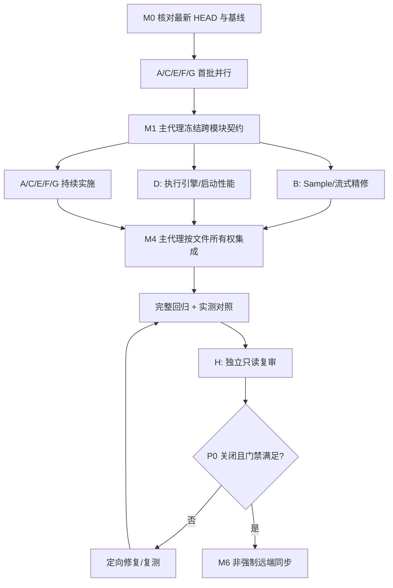

# SS-DE-RPO · 任务拆分、依赖与里程碑

## 任务组织

**1 主代理 + 8 子代理（A～H）**；主代理独占集成与发布，A～F 实施，G 验证，H 终审。审查基线只作线索，当前最新 HEAD 为真实准绳。所有文档访问均从仓库根目录采用 `reference/SS-DE-RPO/` 相对路径。

| ID | 严重度 | Owner | 工作项 | 可验收完成定义 |
|---|---|---|---|---|
| RPO-P0-01 | P0 | A+B | 8 GiB→Sample 内层上限错配修复 | 默认/自定义预算一致、20/363/2044 窗口精修无错误拒绝 |
| RPO-P0-02 | P0 | A+D+F | RAM/VRAM/Disk 跨层治理 | 预算可配置且实际下发，低资源可解释回退，无无声中断 |
| RPO-P0-03 | P0 | C+D | 点击后立即反馈、阻止重复提交 | 双击/连续点击至多一个有效 run，及时状态与取消 |
| RPO-P0-04 | P0 | D+E | 端到端正式结果与持久证据一致性 | 推理、精修、持久发布区分，来源数量/内容可追溯且一致 |
| RPO-P0-05 | P0 | C+E | UX-R6 原有结果生命周期兼容 | 参数变化不误清；新 run 语义依当前 HEAD 核对与测试 |
| RPO-P1-06 | P1 | D+F | 启动链路和首推理加速 | 真实分阶段采样，同设备冷/热对照，无性能倒退 |
| RPO-P1-07 | P1 | B+D | Sample 长信号分块/缓存 | bounded memory、结果时间质量不变、性能有证据 |
| RPO-P1-08 | P1 | E | 高频密度跟踪/融合扩展 | 无比较数硬断裂，preview 限制不影响正式结果 |
| RPO-P1-09 | P1 | F | TensorRT Batch、显存和模型加载 | Batch profile 合法、资源峰值受控，低 VRAM 降级有证据 |
| RPO-P0-10 | P0 | G+H | 测试与独立审查门禁 | R-01～R-20 真实结果清晰，H 阻断项关闭 |

## 波次与文件所有权

**文件归属表**详见 [`07_AGENT_PROTOCOL.md`](07_AGENT_PROTOCOL.md)，禁止多代理同时写入 `detection_task.cpp`、`detection_panel.cpp`、`detection_result_service.cpp`。CPU 与 GPU 运行评估必须协调硬件独占窗口，防止基准因并发干扰失真。

## M0－M6 交付物

- **M0 — 基线**：当前分支信息、未提交改动保护、构建/测试现状、审查线索对应最新代码、实际创建的子代理证明和分支清单。
- **M1 — 契约**：`_delivery/M1_CONTRACT.md`（资源预算强类型、事件流和取消、正式结果规则、profile Batch）、接口所有权冻结。
- **M2 — P0 闭环**：最小重现、代码修复、红绿测试、日志及 UX 状态截图或录屏，按任务编号逐项保存。
- **M3 — P1 性能**：同硬件、模型和参数的冷/热启动 3 次对照、CPU/RAM/VRAM/Disk 峰值、失败退化记录。
- **M4 — 全量集成**：Windows/VS2022/MSVC/Qt 原有工程编译（以实际版本为准）、Debug/Release、CTest/QtTest、真实 IQ 和适用 GPU 回归。
- **M5 — 审查**：H 的独立报告，以及定向复审关闭列表，保留 BLOCKED/UNVERIFIED 而非掩饰。
- **M6 — 发布**：阶段提交、最终 commit、远端同步链接和中文可复核综合报告。

## 不可接受的修复

1. 只把 `1GiB/256Mi`、`maximumDeviceBytes=4GiB` 或其它常量加大，而不区分最大授权与实际峰值；
2. 为通过结果一致性检查而删掉持久 sourceSet 对比或降低数据合法性约束；
3. 假设任意 TensorRT engine 支持从 Batch 2 增到 16，或不保留 profile/VRAM 实测证据；
4. 在后台线程直接更新 QWidget，或靠同步等待来禁用开始按钮；
5. 取消必要的模型/来源身份校验，导致缓存读取过期资产；
6. 更改 FFSCN/SCN 检测数学语义、窄带链路、IQ 样本时间轴，或产生伪造活动区间；
7. 把 fixture 的 PASS 作为真实 GPU 实测证据；
8. 完成时自动覆盖 `main`、`rebuild/a143-native` 或任何无关分支；使用 `--force` 推送。
