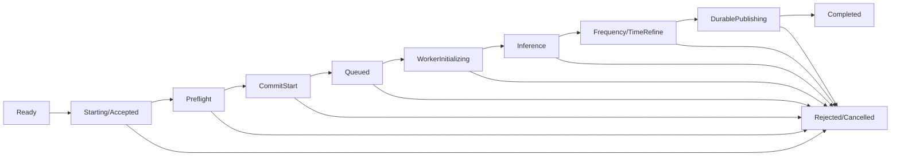

# SS-DE-RPO · 启动链路、状态机与性能指标

## 当前审查时的调用链（最新 HEAD 需重新核对）

`DetectionCard::submit()` → `DetectionPanel::startRequest()` → `runStartCommit()` (model snapshot / source plan / resource preflight / manifest & project save) → `finishStartCommit()` → `DetectionTaskManager::pump()` → `execute()` (source read / QProcess Worker / TensorRT load / first infer / decode / track / checkpoint) → frequency/time refinement → final shards & recovery → `DetectionResultService` 正式结果提交。

## 生命周期状态（允许具体枚举与现有系统适配）

**UI 临时 Starting token 与正式 `runId` 不等价**：应显式关联。只有正式持久发布与事务提交成功才可标记业务 Completed；`windows=N/N` 只说明模型帧处理进度。

## UI 操作约束

| 阶段 | 开始按钮 | 取消 | 参数 | 状态提示 |
|---|---|---|---|---|
| Ready | 可用 | 禁用 | 可编辑 | 就绪 |
| Accepted/Preflight | 立即禁用 | 可用 | 只影响下一次运行 | 正在检查来源/模型/资源 |
| Committing/Queued | 禁用 | 可用（受事务边界约束） | 不更改已冻结的 plan | 保存启动任务、排队 |
| WorkerInitializing | 禁用 | 可用 | 不影响当前任务 | 初始化 Worker/TensorRT |
| Inference/Refinement | 禁用 | 可用 | 下一次配置 | 当前窗口和实际候选进度 |
| DurablePublishing | 禁用 | 根据原子点安全处理 | 下一次配置 | 正在校验并发布正式结果 |
| Completed/Failed/Cancelled | 恢复 | 禁用 | 可编辑 | 成功/具体失败/取消结果 |

避免在 QWidget 线程执行大 IQ 读取、Worker 等待、模型哈希、长 JSON 序列化；仅最小的 UI 状态变更同步，其余后台执行并通过 queued connections 发信号，处理会话切换或对象销毁的事件竞争。状态、窗口、runId、错误码必须一致；原日志的 `interrupted 0/0` 不能被当作新 run 启动开始时间。

## 必备时间线

- `T_click`（真实 UI 点击，以单调时钟记）。
- `T_accepted`（同步禁重并确认 provisional token）。
- `T_preflight_start/end`、`T_model_snapshot_ready`、`T_source_plan_ready`、`T_manifest_committed`。
- `T_worker_spawn`、`T_worker_hello`、`T_engine_ready`、`T_first_iq_read`、`T_first_model_input`、`T_first_infer_start/end`、`T_first_candidate_decoded`、`T_first_preview`。
- `T_inference_complete`、`T_frequency_complete`、`T_sample_refine_complete`、`T_durable_publication`、`T_terminal`。

必须标明测量所用时钟、runId、冷热状态、设备/模型/样本/参数；跨进程比较时钟需使用统一定义或事件传递时的本进程单调时钟，不能无校准相减不同机器时钟。

## 优化策略

- 查明是否重复冻结模型、重复读取 source fingerprint/校验文件、重复构建 SourcePlan、过度工程 JSON copy/write、Worker 冷启动。只消除冗余而不移除必要安全验证。
- 合法缓存需 keyed by file/asset/version/profile/config，源文件发生变化后严格失效；避免每个窗口重复计算 SHA。
- Worker 常驻/复用、GPU 双缓冲、CPU DSP pipeline 先证明模型隔离、内存回收与取消恢复，再采用有界队列/backpressure；结果顺序与物理时间频率坐标不变。
- 预览结果可节流，跟踪融合可增量输出，但正式出版必须符合 source durable 原子性。
- 启动 UI 响应目标 p95 <100ms；同硬件、同配置下冷热各 3 次基线与优化后测量，报告中位/p95/最大及退化项。没有真实测量不承诺任何百分比提升。
