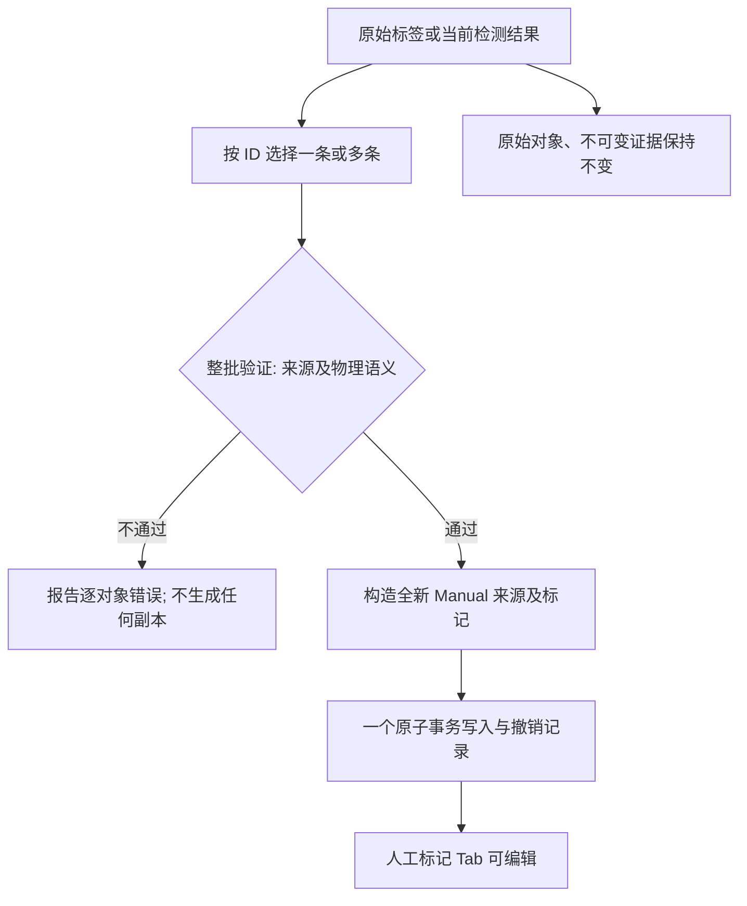
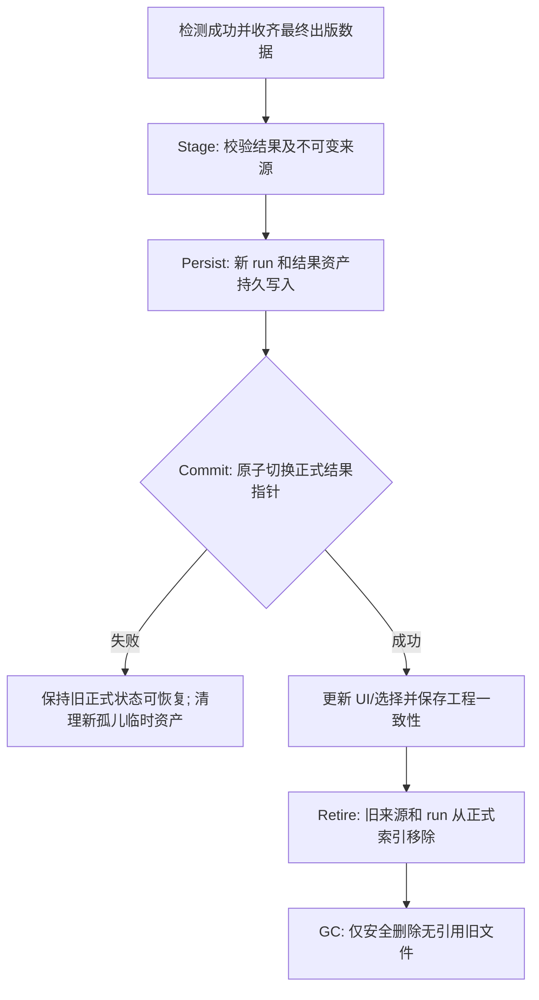

# Signal Studio UX-R5 完整任务规划

**主题：Annotation Source Separation & Current Detection Result Replacement**  
**性质：真实 Qt/C++ 工程专项开发；同时涉及领域权限、数据事务与持久化，不是仅修改表格布局。**  
**目标仓库：** `https://github.com/yulongpo/signal_studio`  
**目标分支：** `rebuild/a143-native`  
**审查时 HEAD（2026-10-26）：** `5b2a499048d64290851ad02ecf764e17cf678231`（后续若更新，以实施时安全核对的远端 HEAD 为准）。

## 0. 需求总纲与边界

### 0.1 必达目标

1. 删除底部“统一标记记录”**混合页面**与来源下拉筛选的业务入口，替换为三个一级 Tab：**原始标签 / 人工标记 / 检测结果**。不是简单把同一张表复制三份：每页独立列、操作和权限，底层仍尽量共享分页/选择/数据服务。
2. 原始标签和检测结果对应的时频矩形、名称、段范围、备注、来源和质量状态**只能查看**，不能在图谱、表格、右侧属性或领域服务层编辑；人工标记唯一可编辑。
3. 原始标签与检测结果支持**单项/多项/当前页/筛选结果批量转换为人工标记**；转换是一项显式、可撤销的复制操作，永不原地更改源类型。
4. 新算法或新参数触发检测更新时，当前结果不能和旧结果累计显示。一次**成功且有效的检测出版**，对同一数据文件与 IQ 样本通道的原正式结果执行**整体替换**；成功 0 结果也清空旧结果。
5. 保留既有原始数据、人工标记、不可变来源证据、必要通道快照和来源诊断。旧算法结果不进入可浏览历史，持久化旧引用安全退役并最终清理，不能通过扫描旧资产“死灰复燃”。
6. 保持 UX-R3 `.ssproj` / v6 兼容性原则、DATA/TXT 与 TorchSig 导入、五个窄带工作页、实际 CPU DDC、FFSCN/SCN TensorRT 路径及 UX-R4 的右侧证据窗口成果。
7. 必须有真实 Qt 原生执行证据和真正独立 Review 子代理 `APPROVED`，才能安全推送远端；不运行无意义批量 SHA 核验。

### 0.2 明确“不做”

- 不重写检测模型、STFT、SCN/FFSCN、推理 TensorRT worker、CUDA 或窄带同步算法。
- 不重新开发 R3 的 `.ssproj` 和标签解析器；不重复 R4 的视觉大翻修。
- 不借取消“统一标记记录”而删除工程树、图谱标记叠加、后台任务状态或完整原始来源证据。
- 不将历史检测结果保留成可浏览的“版本集/模型历史对比”，因为用户明确要求最新结果替换旧结果。
- 不静默转化数据集标签或算法框为人工框；必须由用户显式操作。
- 不添加额外的持续后台监测、无关新功能和批量 hash 盘点。

## 1. 代码审计事实与风险起点

以下为按分支源码审查确证的事实（非本轮已执行的测试）：

| 位置 | 当前行为/字段 | UX-R5 改造切点 |
|---|---|---|
| `domain/annotation.h` | `AnnotationSource{ImportedLabel,Manual,Algorithm}`；`Annotation` 包含 segments、observation、originEvidence、revisions、derivedFrom | 可复用领域实体与来源枚举；补齐转换来源快照和明确能力策略 |
| `domain/project.h` | `FileState::marks` 混放三类对象；`sourceSets`、`detectionRuns`、`selectedMarkIds`；`annotationLayers` 影响 `annotationVisible` | 保持真实数据结构但分离页面投影与图层可见性；定义当前正式检测结果单一作用域 |
| `application/annotation_service.cpp` | `canEdit()` 检查来源存在/有效但未限制 `sourceKind==Manual`；`reviewBatch`、`deleteBatch` 可作用于非人工对象 | 统一服务层读写权限门禁，新增批量复制转换和结果替换专用事务 |
| `AnnotationService::publishSourceSet` | 先验证再添加来源集合及标记；算法来源不进入人工 undo 记录；相同来源幂等 | 不再直接以此作为算法“当前结果更新”的最终发表语义 |
| `ui/annotations/annotation_panel.cpp` | `AnnotationTableModel` 11 列，一张大表；`annotationSourceFilter` 支持“全部来源/原始/手动/算法” | 三页独立投影及对应工具栏；旧混合入口删除，测试按新语义迁移 |
| `ui/charts/plot_widget.cpp` | 绘制标记颜色与句柄，句柄调用 `canEdit()`，当前允许非人工来源视具体条件进入编辑 | 强制仅人工标记可移动、缩放、产生人工修订；只读框仍可选/悬停/定位 |
| `ui/detection/detection_panel.cpp` | `poll()` 先将 run upsert 到 `detectionRuns`，再经 `publishSourceSet()` 追加 Algorithm 标记 | 新正式结果应 stage → validate → atomic replace；旧 run 需退役隔离与垃圾回收 |
| `infrastructure/detection_store.*` | 检测 manifest/chunk/head 持久化与 `discoverDetectionRuns()` 扫描恢复 | 清理必须尊重持久化引用和崩溃恢复，不能只删 UI/内存；已退役 run 不能自动恢复 |
| `AnnotationChannelSnapshot` | 通道引用 annotationId/segmentId/revisionId 及创建时几何与 SourceIdentity | 保护已创建通道，无需保存完整旧算法框才能维持快照与源文件可追溯性 |
| `app/main_window.cpp` | 底部一级按钮为“统一标记记录/后台任务/日志” | 新的三个业务页 + 后台任务/日志作为辅助入口，原 `resultTab` 事件与对象名适配 |

### 1.1 必须先完成的现状梳理

执行 Agent 需读取 `AGENTS.md` 和上述现行源码/测试，输出到 `docs/implementation/ux-r5/BASELINE_AUDIT.md`：

- 当前 UI 类型、业务命令、Qt objectName、调用链、哪些写入口需要收口。
- 当前检测任务/来源集合/结果/工程资产在内存及磁盘上的引用图；哪些数据属正式结果、运行任务证据和缓存。
- 原始 `.ssproj`/v6 项目中标记与检测运行怎么编码、加载、验证以及如何处理缺失引用。
- 哪些文件的修改影响现有 R3/R4 验收，旧用例如何迁移而非简单删除。

文档必须明确“源码已证实”和“待运行验证”两类结论。

## 2. 产品信息架构：三个来源 Tab

### 2.1 底部工作区

建议的一级导航：

```text
┌──────────────────────────────────────────────────────────────────────────┐
│ [原始标签 11] [人工标记 4] [检测结果 8]      [后台任务] [日志]   [∧收合]│
├──────────────────────────────────────────────────────────────────────────┤
│ 当前 Tab 自己的查询、筛选、批量选择及工具栏                               │
│ ┌──────────────────────────────────────────────────────────────────────┐ │
│ │ 每页独立的列与结果表格                                                 │ │
│ └──────────────────────────────────────────────────────────────────────┘ │
│ 页码 / 已筛选 / 已选中 / 当前对象                                       │
└──────────────────────────────────────────────────────────────────────────┘
```

- `原始标签` 优先：类别/名称、段数、开始、结束、中心频率、带宽、数据集来源、来源有效性；操作为定位、查看原文、单/批转换、导出、重导入源标签（来源管理独立，不是修改框）。
- `人工标记` 优先：名称、类别、范围、段数、备注、关联窄带通道；操作为新建、编辑、拆分、合并、复制、删除、撤销/重做、创建窄带通道、定位与导出。
- `检测结果` 优先：当前算法、结果名称、时间范围/未知、中心频率、带宽、分数、覆盖质量；操作为定位、查看不可变技术证据、单/批转换、导出。无结果时区分“未运行”“运行中”“成功 0 检出”“取消/失败”。
- `后台任务` 与 `日志` 作为右侧独立辅助按钮/工具页签保留；不可被删掉或改成三类数据的一部分。
- 各页分页至少维持现有 200 行可视页设计及大数据集合性能；批量选择语义明确区分“本页”和“筛选结果全集”。
- 三类来源可以共享底层 `QAbstractTableModel` 抽象/排序数据提供者，但**不能共用不加区分的可编辑列/操作工具栏**。

### 2.2 表格与时频图图层分离

现有 `annotationVisible` 同时受 `annotationLayers` 控制。新方案应将概念拆开：

- `annotationInContext`：该标记属于当前文件、样本通道并且未退役。
- `annotationEligibleForTab`：上下文合法、sourceKind 匹配当前 Tab 且满足该页的质量/分数/类别过滤；**不能因为关闭图谱叠加层而从表中消失**。
- `annotationOverlayVisible`：满足上下文与图谱图层开关、显式叠加过滤、当前正式检测结果等条件；只决定绘图。
- `annotationSelectable`：允许表格、工程树和图谱实体参与选择，不等价于可编辑，也不应在关闭图谱图层后悄然拒绝表格选择。

需对现有 `Session::selectMarks` / `AnnotationService::select` 的过滤逻辑做最小但一致的调整，避免 Tab 项可见却不能勾选。图层隐藏时定位可选择提示“当前图层已隐藏”，不自动篡改用户叠加选项。

### 2.3 选择行为

- 三个 Tab 共享唯一 `activeMarkId/selectedMarkIds`，但切换 Tab 时，UI 选择投影仅包含本来源对象。可采用来源交集/清空不可见选择，避免在人工页按删除误操作其它 Tab 的对象。
- `Ctrl/Shift` 多选只依据当前页排序/过滤后的完整 ID 顺序；已分页对象允许保持 ID 选择，不能误将页面索引当对象身份。
- 单击选择不缩放，双击明确定位或打开只读详情；`定位` 才调整时频图可视范围。
- 工程树、时频图和右侧属性面板按同一业务 ID/segment ID 联动；点选某源类对象应切换到对应 Tab 或显示清晰来源标识。
- 区分来源颜色、选中/悬停/焦点/活动段高亮，不允许因来源只读而失去视觉反馈。

### 2.4 右侧标记属性

- 原始标签/检测结果显示只读物理值与来源证据，禁用且移除编辑按钮、几何输入、拆分/合并/删除入口。应显示“只读 · 转换为人工标记后可编辑”。
- 人工标记延续 UX-R4 简洁范围编辑、段管理、定位和来源详情弹窗。
- 隐藏完整 SHA/UUID/原始 JSON 的默认常驻展示；详细不可变原文继续在独立证据窗口按需查看及完整复制。
- `创建窄带通道` 主入口以**人工标记为源**；用户在其它两类下触发时，显示“转换并创建通道”的显式确认流程。

## 3. 核心领域政策：只读权限为服务层强制不变量

建立集中式来源能力策略（名字仅为建议），而不是在不同 QWidget 上分别写 `if`：

```cpp
struct AnnotationCapabilities {
    bool view = true;
    bool select = true;
    bool locate = true;
    bool exportData = true;
    bool convertToManual = false;
    bool editGeometry = false;
    bool editMetadata = false;
    bool manageSegments = false;
    bool review = false;
    bool deleteAnnotation = false;
    bool createChannelDirectly = false;
};

AnnotationCapabilities capabilities(const FileState&, const Annotation&);
```

建议规则矩阵：

| 来源 | 查看/选择/定位/导出 | 直接几何/名称/段/质量复核/删除 | 转人工副本 | 直接创建新通道 |
|---|---|---|---|---|
| ImportedLabel | 允许 | 禁止 | 允许 | 禁止；先显式转换 |
| Manual | 允许 | 允许（须来源合法） | 不需要 | 允许（满足活动段/物理约束） |
| Algorithm | 允许（限当前正式结果） | 禁止 | 允许 | 禁止；先显式转换 |

- 修改 `canEdit` 为“来源为 Manual && 原有身份合法性检查”，并为 `reviewBatch`、`deleteBatch`、`rename`、`restoreOrigin`、`confirmSegment`、`adoptObservation` 等补齐服务层权限拒绝；检查 `session`、图谱 context menu、表格 inline 编辑等入口。
- 只读**不等于冻结原始来源文件管理**。用户仍可重新导入 TXT/SigMF 或移除整个标签数据源；这属于带确认的来源级管理事务，与修改单个原始框严格区分，不允许旁路只读策略。
- 算法结果的“替换/退役”是由检测服务独占的系统级操作，不能通过普通用户删除 API 绕开权限。
- `undo/redo` 只针对人工命令及合法的转换批次；系统检测替换不进入用户可撤销的人工栈（否则会把被删除的旧结果恢复）。
- 只读约束必须在领域服务层和图谱交互状态机均生效，避免 UI 禁用而热键/直接 API 仍可编辑。

## 4. 单个及批量转换为人工标记

### 4.1 必须采用复制语义



- 新副本必须是 `sourceKind=Manual`、独立 `id`/`sourceSetId`/初始 revision，不得修改原来源对象或原来源集合。
- 复制全部合法 `segments` 的物理范围、频率坐标系、时间质量、类别、名称等；**不改变样本索引的半开区间** `[begin,end)`，不能凭空补齐时间未知的算法观察。
- 拷贝 `observation` 时仍为**观察**，不是活动段。时间未知时用户可稍后显式采用可见时间窗/手工圈选生成段，UI 需说明它是用户设定。
- 记录来源追溯：`derivedFrom` + `sourceKind` + `originRecordId` + 来源简要身份、原始类别、原始观察/段几何及生成时配置摘要。对于会被算法整体替换的源，人工副本必须是**自包含**的关键来源快照，不依赖可清理的旧 run/chunk/annotation 对象继续存在。
- 转换后人工副本可编辑，与原始框的未来刷新/替换绝无双向绑定。
- 同一源对象默认阻止误触重复复制，允许明确执行“再建一个独立副本”；判重必须兼顾不同源修订、特定段和用户主动再次转换。
- 选择“转换全部段”与“只转换当前段”的语义应明确。默认“一来源对象 → 一人工对象，保留全部有效段”。
- 批量必须全量前置验证后一次提交，不允许半成功；预算应复用现有对象数、内存占用和撤销命令上限，在大批量情况下提供明确分批建议而非静默截断。
- 转换完成后切到人工标记 Tab 并选中生成对象（多选保持），允许一次撤销整个批次。

### 4.2 接口建议（不锁死具体名字）

```cpp
struct ManualConversionOptions {
    bool currentSegmentOnly = false;
    bool allowExplicitDuplicate = false;
};
AnnotationResult convertToManual(
    FileState& file,
    const std::vector<std::string>& sourceIds,
    const ManualConversionOptions& options,
    std::vector<std::string>& createdIds);
```

实现应调用现有 `AnnotationService` 的原子命令模型，避免重复构造两套撤销历史。`createManual` 可以作为内部构造参考，但不能逐个 commit 导致批量部分完成。必要时增加 `originSnapshot` 小结构，兼容旧工程加载后缺省处理。

## 5. 检测结果生命周期：当前一套、整体替换、无旧结果历史

### 5.1 作用域与含义

唯一正式结果作用域：`FileMetadata.id + selectedSampleChannel`，并核对 SourceIdentity 绑定。**不按模型种类保留 SCN/FFSCN 两套结果，也不按 ROI 分段累积旧结果。**

- 当前算法/模型参数变化 -> 当前正式结果标识“待更新/已过时”，旧框不再被误标成新配置输出。建议默认用户按“应用并重新检测”启动重跑，不在每次下拉变化/键入时自动开重任务。可提供显式“更改并运行”快捷动作，且不允许静默触发大量 TensorRT 计算。
- 新任务运行时 -> 临时结果与正式结果隔离；页面可提供“处理中”占位/临时预览开关，但所有临时框不能被转换、持久化为人工标记或当作正式检测事实。
- 成功完成且发布验证通过 -> **原子替换**此作用域内的旧 Algorithm 来源集合、标记集合和正式 run 引用；如新结果为 0 条，也清空旧集合并显示“已完成，未检出”。
- 用户取消/任务失败/来源改变 -> 不发布部分结果，错误清晰可见。旧有效集合可仅作为**事务回滚恢复数据**暂存，不可在当前配置的正式检测结果 Tab 当作最新结果展示；不建立旧模型历史库。
- 新 ROI/可见范围的成功检测是**整批替换**；ROI 外必须显示“本次未检测”，不能混入之前算法的 ROI 外框或误判无信号。
- 对于文件切换、通道切换、任务 generation 改变时，发布必须校验请求所属身份和不可变 token，杜绝迟到 worker 覆写新结果。

### 5.2 两阶段安全提交（必要）



**不建议先从 `marks` 直接 `erase_if`，再向同一容器追加新结果。** 因为：

- `AnnotationService::publishSourceSet` 当前是“追加/幂等”，不是“替换”。
- `.ssproj` manifest 与 detection run 的持久分片需要引用一致。
- 旧 `AnnotationChannelSnapshot` 与 `derivedFrom` 引用需处理；任务恢复扫描 `discoverDetectionRuns` 可能重新导入旧 run。
- 保存/崩溃/磁盘空间不足时先删旧数据有破坏风险。

建议引入清晰的 `CurrentDetectionSlot` / `ResultGeneration` 或等价的轻量状态索引（名称仅示意）：

```text
scope = (fileId, selectedSampleChannel)
committedRunId = 本作用域唯一正式 run 或空
committedGeneration = 单调递增（或稳定唯一代次）
pendingRunId = 可选，不属于正式结果
retiredRunIds = 按需使用的短期回收/防复活标记（不能含完整旧结果）
```

可复用现有 `FileState::detectionRuns` 与 project manifest，而不另建全量历史对象池；具体容器形态应根据实际 codec 与存储 API 确定。若新增不可兼容必需持久字段，须提出明确版本迁移方案；若通过可选字段扩展 v6，可保留 v6 但必须有强制缺省解释和旧 run 减少到一套的确定性迁移。

### 5.3 何时清理旧 run

- 只保留**正式当前结果及必要在途任务**的可见状态；旧 Algorithm 标记不在表格/时频图/工程树/导出和“恢复旧任务”里出现。
- 内存撤销栈不能引用旧系统级结果以令其意外复活；转换人工副本中保留可追溯**最小充分快照**。
- 磁盘旧 chunk/head/manifest 使用引用计数或基于 canonical manifest 的可达性扫描后垃圾回收；**只允许删除此项目拥有、处于受控资产根内、经明确分类无引用的文件**，不得按文件名模式盲删外部 IQ/标签/模型文件。
- 删除策略需应对 `Reference` / `Copy` 两种工程资产根，避免误删用户手工共享文件；保存/另存的资产根变更要安全。
- 如果旧 manifest 仍物理存在但已退役，`discoverDetectionRuns` 恢复逻辑必须参照当前提交索引/退役清单过滤，避免旧算法结果重开后出现。
- 失败、取消、运行中保存/恢复、成功 0 结果及程序在**stage/persist/commit/gc 任一点崩溃**均必须保证：重开后正式结果要么仍为上次有效集合，要么为完整新集合，不能出现新旧混杂、凭空消失或旧结果复活。

### 5.4 与通道绑定的特殊要求

- 新通道业务入口仅接收人工标记（或必须显式转换后创建），不得因为算法替换让实时引用自动切换到另一组几何。
- **旧项目里从 ImportedLabel/Algorithm 直接创建的通道必须兼容读取**；不得强制删除它们、修改既有 IQ 裁剪、输出采样率或滤波配置。
- 通道 `sourceSnapshot` 中的创建几何、sample identity 和来源状态须保留。旧 Algorithm 对象清理后，通道可能展示“原检测来源已退役，仍保留创建快照”，需要与“源 IQ 文件缺失”明确区分。
- 不能为了保持旧引用而无限保留一整套旧算法结果；应允许快照脱离源标记而只保留独立的必要追溯摘要。若需新增来源关系枚举，必须更新 project codec 兼容映射及文档。

## 6. 工程管理和迁移

- 导入已有 `.ssproj`/v6（包含多个 Algorithm sourceSets、detectionRuns、旧人工编辑过的导入/算法标记）不得失败或自动污染人工集合。
- 正式运行迁移策略需明确：选出**时间上最新且已完成、来源有效并已持久发布**的一套作为当前结果；无法唯一判定时须明确报诊断或用户选择，禁止猜测并丢数据。
- **旧非 Manual 来源的历史人工修订**：用户以前可能直接拖改原始标签/算法框。迁移时不要静默丢失修订；推荐将修改后的状态转换成独立 Manual 副本，原始来源以原始几何恢复只读，保留修订/来源链及明确迁移日志。存在歧义时只读预览或用户确认，不自动覆盖。
- 即使工程中发现几十个历史检测 run，迁移后的正式结果也必须至多一套。原始 run 需在成功保存新工程事务后才能安全退役/GC。
- 读旧工程时遵循“加载到临时 Project → 验证 → 应用/转换/原子保存”的顺序；任何转换失败应保留原工程不变。
- 工程另存、移动和恢复来源时，检测 slot 与资产可达性关系应保持一致；不能把外部 `Reference` 资产作为私有垃圾删除。
- 产品已经具备 `.ssproj`，新版本不要退回按文件夹标识工程。

## 7. 结构建议与实现指导

推荐增量模块化，而非大重构：

```text
application/
  annotation_service.{h,cpp}          # 编辑能力、转换批量事务与命令历史
  detection_result_service.{h,cpp}   # （可选新增）正式结果 slot、替换状态机
ui/annotations/
  annotation_panel.{h,cpp}           # 三 Tab 容器与工具栏
  annotation_table_models.*          # （可选拆分）共享底层+来源专属列
ui/detection/
  detection_panel.cpp                # 发布完成回调接入替换服务
ui/charts/
  plot_widget.cpp                    # 只读叠加与手工控点
infrastructure/
  project_store.cpp / project_file.cpp
  detection_store.cpp                # manifest/recover/retired/gc
  annotation_json.cpp                # 转换最小来源快照序列化（如需要）
app/
  main_window.cpp                    # 底部入口、右侧属性和选择联动
```

约束：

- 源对象权限、正式 slot 替换、资源清理放在服务层，UI 只做命令调度和信息展示。
- `annotationSourceIdentity`、物理范围验证、样本边界及频率轴语义统一沿用原有函数，不另写重复转换。
- 原始 label、Algorithm 源证据不可变；UI 的“隐藏旧结果”不能等于改写/伪造原始记录。
- 保留历史对象名时应更新其可访问语义；废弃 `annotationSourceFilter`、`annotationTable`、`resultTab` 的地方，测试要迁移并提供明确兼容映射，不留空壳欺骗自动化。
- `QSettings` 可保留用户最近选择的 Tab，但当前项目来源/选择的正确性不得依赖全局 QSettings。

## 8. R5-0 至 R5-7 分阶段任务

| 阶段 | 交付 | 完成条件 |
|---|---|---|
| **R5-0 基线核查** | `BASELINE_AUDIT.md`、当前 HEAD/remote 对齐、对象与存储引用图 | 不动工作区未跟踪资料；精简 Git 检查，无整仓 hash |
| **R5-1 UX/领域合同** | `DESIGN.md`、`DATA_LIFECYCLE.md`、Qt 真实可达的交互方案（可选 HTML 仅辅助） | 三页列/权限/同步、转换、替换与故障恢复语义冻结 |
| **R5-2 只读能力** | 服务层能力策略、Qt 标记只读、右侧 inspector/树/菜单适配 | 任意 API 和图形拖放均无法改非 Manual 来源；其查看和选择正常 |
| **R5-3 三 Tab 与转换** | 共享数据投影、三个独立业务页、单/批转换、原子撤销与来源快照 | 不再出现统一混合表；真实来源和人工副本相互独立 |
| **R5-4 当前检测结果替换** | 单一正式 slot、两阶段提交、零结果、旧来源/任务退役、可达性 GC | 成功更新只有最新结果；失败/取消无混杂；重开不复活旧结果 |
| **R5-5 迁移与通道兼容** | `.ssproj` 兼容、历史编辑处理、旧算法来源通道快照保护 | 旧工程可安全打开/迁移；现有通道无丢失或暗改 |
| **R5-6 验证与交付** | Debug/Release、定向 Qt/CTest、真实 Qt 截图、崩溃恢复、`VALIDATION.md` | 所有高优先级验收真实通过；跳过/失败如实说明 |
| **R5-7 独立终审与安全同步** | 精确 HEAD 独立 Review、报告、推送与再核对 | 仅 APPROVED 才允许正常推送；失败/无法子代理即本地阻断 |

每阶段允许本地 commit。开发 Agent 不得把需要修复的失败用例归为“历史原因”而自行放行。

## 9. 验证原则与资源预算

### 9.1 测试

完整测试矩阵见 `ACCEPTANCE_MATRIX.md`。特别重要：

- 三来源服务 API 禁止写入；100% 验证 UI 禁用和绕 UI API 拒绝。
- 单/批转换中源对象 JSON/段几何未发生变化，人工副本有完整必要几何且相互独立。
- 跑 A→B→A 检测成功后只有最近 A 结果，0 检出也正确清空；不同源文件/样本通道完全隔离。
- 新任务中断/失败/取消不发布临时结果；保存和重开工程检查事务一致性。
- 已退役 run 经目录扫描、项目重开、恢复对话框不能复活；磁盘 GC 不误删外部资源。
- 旧项目中直接绑定算法结果的通道仍拥有原几何快照，处理参数不变；来源状态解释正确。
- 底部三 Tab、图谱选择、工程树、右侧属性和 4K/150% DPI 真实 Qt 对齐。

### 9.2 性能

- 重用当前每页最多 200 行及冻结 id 快照机制；10 万 segment 与大文件不能因全表 UI 重建导致阻塞。
- 批量转换前校验与一次性提交，避免每对象完整项目拷贝造成不必要的 O(N²)。
- 大型检测结果 GC 不应在 GUI 主线程同步遍历/删除所有分片；取消/失败应有实时状态。
- 引用关系扫描和保存使用 bounded memory，遵守已有 32 MiB 元数据预算、128 MiB 人工命令预算等合同；如需调整须基于测量并经独立审核。

### 9.3 原生验收

优先运行此前有证据的 Windows 4K、150% DPI 屏幕，Debug/Release 至少各完成核心流程；能用现有 GPU/软件渲染器时做四组合复核。若实际设备不存在或无法访问，**不得伪称已验证**，将缺失场景标注 BLOCKED/证据不足；不能使用 offscreen 图片冒充实屏。

## 10. 文档、证据与最终交付目录

```text
reference/ux-r5/                        # 本用户输入规划（不修改/丢弃）
  README.md
  PLAN.md
  CODEX_MASTER_PROMPT.md
  ACCEPTANCE_MATRIX.md
  INDEPENDENT_REVIEW_GATE.md

docs/implementation/ux-r5/              # 开发 Agent 的版本内交付
  BASELINE_AUDIT.md
  DESIGN.md
  DATA_LIFECYCLE.md
  IMPLEMENTATION.md
  MIGRATION.md
  VALIDATION.md
  DELIVERY.md
  evidence/...

out/tasks/ux-r5/                        # 最终 HEAD 审核后单独保留的外部证据
  INDEPENDENT_REVIEW.md
  PUBLISH_RECORD.json
```

`DELIVERY.md` 列出阶段提交、实际构建运行命令、测试通过/失败/跳过、准确 Qt 设备、来源证据及用户可运行部署物路径。不能只写“全部完成”。

## 11. 关键风险与优先决策

| 风险 | 后果 | 处置 |
|---|---|---|
| 只做 UI 禁用未修改服务 API | 非 Manual 仍可被热键/脚本修改 | R5-2 先做领域能力限制 |
| 图层关闭导致 Tab 列表也消失 | 不能选取与转换只读对象 | 分离 Tab 查询、overlay 可见性、选择合法性 |
| 旧检测任务 scan 自动恢复 | 被替换结果再次出现 | 正式 slot + retired registry + GC / recover 过滤 |
| 成功 0 结果误认为未变化 | 留下旧检测框 | 0 结果视为合法完成替换为空 |
| 批量转换仅逐项调用 createManual | 中途部分成功/撤销不一致 | 一次验证一次事务一次撤销 |
| 人工副本仅记旧 Algorithm ID | GC 后溯源断裂 | 最小必要自包含来源快照 |
| 直接删除旧 run/chunk | 旧通道/引用模式/崩溃恢复损坏 | 资产可达性与提交后 GC |
| 旧非 Manual 已有历史人工修订 | 启用只读后用户原编辑“丢失” | 显式生成 Manual 副本并保留原证据 |
| 对算法参数每次键入立即跑模型 | 不必要重计算及 UI 卡顿 | 显式“应用并重新检测”；快速路径合并操作 |
| 对外部 `Reference` 资产执行 GC | 删除用户共享数据 | 仅 GC 工程自有资产根，精确引用核验 |
| 为审查重复 SHA 盘点 | 浪费时间/算力 | 仅 HEAD/祖先/产品必要完整性校验 |
| 审核后报告 commit 改变 HEAD | 批准失效 | 独立报告放仓库外或重审变更后 HEAD |

## 12. 任务结束定义 (Definition of Done)

必须同时满足：

- 真实业务页面已替换为三 Tab，无统一混合业务表；辅助后台任务、日志仍在。
- 原始/算法对象全链路只读；人工编辑与来源证据完全保真。
- 单/批转换可靠可撤销；来源和人工副本不互相影响。
- 检测当前结果只保留最新完成的一套；成功 0 结果清空；错误/中断不产生混杂结果；重启旧 run 不复活。
- 通道快照、旧工程及 Copy/Reference 资产稳定。
- Debug/Release、关键真实 Qt 原生场景及持久化/恢复测试有实际证据，问题如实披露。
- 真正独立 Review 子代理批准最后精确 HEAD，并在安全 Git 检查后才向目标分支进行非强制推送。否则保持本地交付，明确阻断原因。
